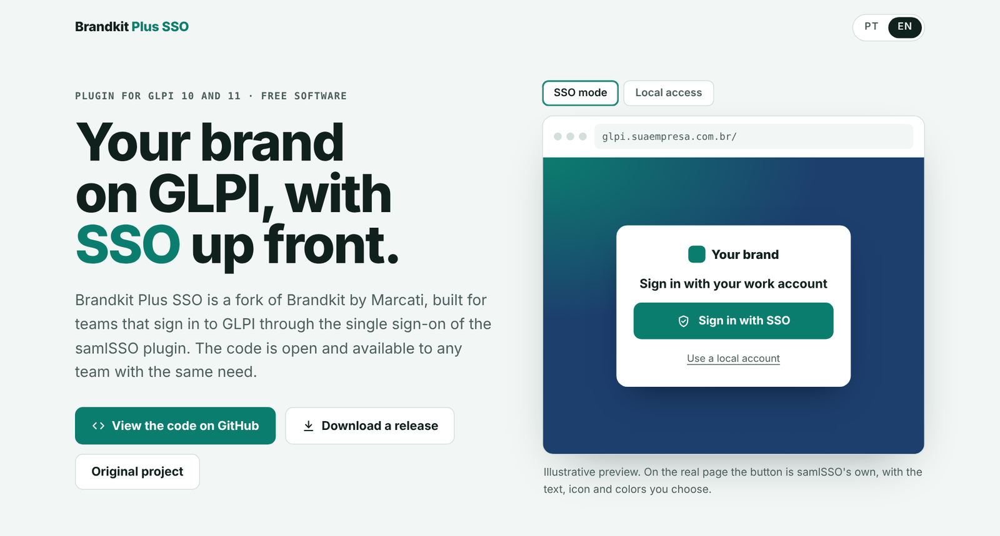

<a href="https://kibinluck.github.io/brandkit-plus-sso/">
  <picture>
    <source media="(prefers-color-scheme: dark)" srcset="docs/assets/banner-dark.png">
    
  </picture>
</a>

# Brandkit Plus SSO

Easily customize GLPI with your own brand, now with SSO login support for the
[samlSSO](https://github.com/DonutsNL/samlsso) plugin. A fork of
[Brandkit](https://github.com/juniormarcati/glpi-brandkit) by [Marcati](https://github.com/juniormarcati).

**[Project page](https://kibinluck.github.io/brandkit-plus-sso/)** ·
**[Download](https://github.com/kibinluck/brandkit-plus-sso/releases)** ·
**[Changelog](CHANGELOG.md)** ·
**[Original project](https://github.com/juniormarcati/glpi-brandkit)**

**Languages:** [English](#english) | [Português (BR)](#portugues-br)

---

<a id="english"></a>

## Why this fork exists

Our users sign in to GLPI through corporate SSO, using the samlSSO plugin. Even so, the login
page kept the username and password fields front and center, while the SSO button sat small
under the form, with the provider name cut to 12 characters. People who only needed to click a
button ended up typing their password in the wrong place.

Brandkit already handled the visual identity: logos, colors, layouts and the login wallpaper.
What it lacked was a fit with SSO. This fork adds an SSO mode that hides the local fields and
puts the button in the middle, without locking administrators out: local accounts still sign in
at their own address.

Along the way we fixed layout issues found in production and reviewed the plugin's security.
We are publishing the result so other teams don't have to start from scratch.

## What changes

**SSO mode**
- Hides username and password and puts the SSO button in their place, styled like the login button.
- Only acts when an SSO button is on the page. If samlSSO is disabled, the normal form comes back on its own.
- Local access at `https://your-glpi/?bypass=1&noAUTO=1`, the same bypass address samlSSO uses. That page hides the SSO button.
- Configurable button text, icon (the SSO plugin's, the colored Microsoft logo, or none) and colors.

**Fixes**
- Two-factor authentication page layout ([issue #4](https://github.com/juniormarcati/glpi-brandkit/issues/4) on the original).
- Copyright footer, error message buttons and FAQ button aligned with the login area.
- Login page fixed for phones.

**Security and upkeep**
- Uploaded images are validated and re-encoded; files disguised as images are rejected.
- GLPI's original logos are backed up and restored.
- Installs from the GLPI 11 marketplace folder.
- Full pt_BR translation.

## Install

1. Download the zip from [Releases](https://github.com/kibinluck/brandkit-plus-sso/releases), or clone
   the repository into GLPI's plugin folder (`plugins/`, or `marketplace/` on GLPI 11). The folder
   **must** be named `brandkit` (it is the plugin key):
   ```bash
   cd /path/to/glpi/plugins
   git clone https://github.com/kibinluck/brandkit-plus-sso.git brandkit
   ```
2. In GLPI: **Setup › Plugins**, then **Install** and **Enable**.
3. In **Plugins › Brandkit Plus SSO › Login Page**, turn on SSO mode, adjust the button and keep the
   local access address somewhere safe.

**Already using the original Brandkit?** The plugin key is the same (`brandkit`). Replace the folder
and your settings and images stay in place.

**Requirements:** GLPI 10.0 or 11.0, PHP 7.4+ (8.2+ on GLPI 11), the PHP `gd` extension (already
required by GLPI). GLPI 12 is not supported yet: GLPI will refuse to enable the plugin there until it
has been tested.

The web server user needs write access to GLPI's `pics/` folder (`public/pics/` on GLPI 11):
the plugin replaces GLPI's own logo and favicon files there and publishes the login wallpaper next
to them. Originals are backed up and put back when a logo is removed or the plugin is uninstalled.

## Configuration

- After enabling, a **Brandkit Plus SSO** entry appears under **Plugins** (only for profiles allowed
  to update the GLPI setup).
- **GLPI logos:** menu logos (light/dark, expanded/collapsed), login logo and favicon.
- **Login Page:** layout, colors, fields, button, wallpaper and SSO mode.

**Known issue:** behind **Nginx Proxy Manager**, you may need to disable **Block Common Exploits**
so the plugin assets load correctly.

## Thanks

This project exists only because Marcati published [Brandkit](https://github.com/juniormarcati/glpi-brandkit)
as free software. All of the customization groundwork, from logos to login page layouts, is the
original author's work. Thanks also to the [samlSSO](https://github.com/DonutsNL/samlsso) maintainers,
who brought SAML sign-in to GLPI.

Brandkit Plus SSO was developed with Claude (Anthropic), under the guidance and supervision of
Bruno Braz. It is an independent fork and is not maintained by the original author.

## Open source

The code is under the same license as the original project (see [LICENSE](LICENSE)). You may use,
modify and redistribute it, as long as you keep the credits and the license and publish the source
of your changes. Found a problem or have an improvement? Open an
[issue](https://github.com/kibinluck/brandkit-plus-sso/issues) or send a pull request.

---

<a id="portugues-br"></a>

## Português (BR)

Personalize o GLPI com a sua marca de forma simples e prática, agora com suporte ao login SSO do
plugin [samlSSO](https://github.com/DonutsNL/samlsso). Fork do
[Brandkit](https://github.com/juniormarcati/glpi-brandkit), da [Marcati](https://github.com/juniormarcati).

### Por que este fork existe

Nossos usuários entram no GLPI pelo SSO corporativo, com o plugin samlSSO. Mesmo assim, a tela de
login continuava mostrando usuário e senha em destaque, e o botão de SSO ficava pequeno, abaixo do
formulário, com o nome do provedor cortado em 12 caracteres. Quem só precisava clicar em um botão
acabava digitando a senha no lugar errado.

O Brandkit já resolvia a identidade visual: logos, cores, layouts e papel de parede da tela de
login. Faltava o encaixe com o SSO. Este fork acrescenta um modo SSO que esconde os campos locais e
coloca o botão no centro, sem tirar o acesso dos administradores: as contas locais continuam
entrando por um endereço próprio.

No caminho, corrigimos problemas de layout que apareceram em produção e revisamos a segurança do
plugin. Publicamos o resultado para que outras equipes não precisem começar do zero.

### O que muda

**Modo SSO**
- Esconde usuário e senha e coloca o botão SSO no lugar, com o estilo do botão de login.
- Só age quando há um botão SSO na página. Se o samlSSO for desativado, o formulário normal volta sozinho.
- Acesso local em `https://seu-glpi/?bypass=1&noAUTO=1`, o mesmo endereço de bypass do samlSSO. Nessa página, o botão SSO some.
- Texto, ícone (o do plugin de SSO, o logo colorido da Microsoft ou nenhum) e cores do botão configuráveis.

**Correções**
- Layout das telas de autenticação em dois fatores ([issue #4](https://github.com/juniormarcati/glpi-brandkit/issues/4) do original).
- Rodapé de copyright, botões das mensagens de erro e botão FAQ alinhados à área de login.
- Tela de login ajustada para celular.

**Segurança e manutenção**
- Imagens enviadas são validadas e reprocessadas; arquivos disfarçados de imagem são recusados.
- Backup e restauração dos logos originais do GLPI.
- Instalação pelo marketplace do GLPI 11.
- Tradução pt_BR completa.

### Instalação

1. Baixe o zip em [Releases](https://github.com/kibinluck/brandkit-plus-sso/releases) ou clone o
   repositório na pasta de plugins do GLPI (`plugins/`, ou `marketplace/` no GLPI 11). A pasta
   **precisa** se chamar `brandkit` (é a chave do plugin):
   ```bash
   cd /caminho/do/glpi/plugins
   git clone https://github.com/kibinluck/brandkit-plus-sso.git brandkit
   ```
2. No GLPI: **Configurar › Plugins**, depois **Instalar** e **Habilitar**.
3. Em **Plugins › Brandkit Plus SSO › Página de login**, ative o modo SSO, ajuste o botão e guarde o
   endereço de acesso local.

**Já usa o Brandkit original?** A chave do plugin é a mesma (`brandkit`). Basta substituir a pasta:
as configurações e as imagens continuam lá.

**Requisitos:** GLPI 10.0 ou 11.0, PHP 7.4+ (8.2+ no GLPI 11), extensão `gd` do PHP (já exigida pelo
GLPI). O GLPI 12 ainda não é suportado: o GLPI não deixa habilitar o plugin nessa versão até que ela
seja testada.

O usuário do servidor web precisa de permissão de escrita na pasta `pics/` do GLPI (`public/pics/`
no GLPI 11): o plugin substitui ali os logos e o favicon do GLPI e publica o papel de parede do
login. Os originais ficam guardados e voltam quando um logo é removido ou o plugin é desinstalado.

**Problema conhecido:** atrás do **Nginx Proxy Manager**, pode ser necessário desativar
**Block Common Exploits** para que os recursos do plugin carreguem corretamente.

### Agradecimentos

Este projeto só existe porque a Marcati publicou o [Brandkit](https://github.com/juniormarcati/glpi-brandkit)
como software livre. Toda a base de personalização, dos logos aos layouts da tela de login, é
trabalho do autor original. Agradecemos também aos mantenedores do
[samlSSO](https://github.com/DonutsNL/samlsso), que trouxeram o login SAML para o GLPI.

O Brandkit Plus SSO foi desenvolvido com o Claude (Anthropic), sob a orientação e supervisão de
Bruno Braz. É um fork independente e não é mantido pelo autor original.

### Código aberto

O código está sob a mesma licença do projeto original (veja [LICENSE](LICENSE)). Você pode usar,
modificar e redistribuir, desde que mantenha os créditos e a licença e publique o código das suas
alterações. Encontrou um problema ou tem uma melhoria? Abra uma
[issue](https://github.com/kibinluck/brandkit-plus-sso/issues) ou envie um pull request.
